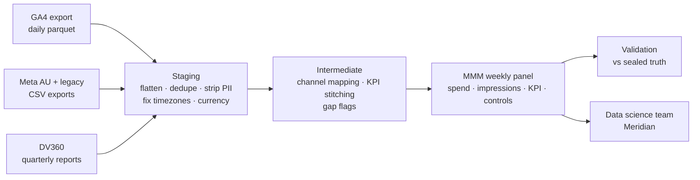

# Harbourline Bank: MMM data foundations (synthetic practice engagement)

A practice engagement that mimics real agency work for a bank. The job is to turn raw **GA4, Meta and DV360** data into a clean, weekly, model-ready table that a data science team can feed into **Google Meridian** (marketing mix modelling).

All data here is **synthetic**. A seeded Python generator produces it, and it is deliberately messy in the ways real client data is.

---

## Why this repo exists

I'm a Senior BI Developer with around 10 years of experience turning marketing, customer and app data into trusted models on BigQuery. My production web analytics work has been on **Adobe Analytics, not GA4**, and preparing data for MMM is new to me.

Rather than wait for a role to give me that experience, I'm building it here, on data that behaves like the real thing. I commit as I go, so the history shows the work.

## The scenario

**Harbourline Bank** is a fictional mid-sized Australian bank with three products: **home loans, credit cards and savings accounts**. Its data science team plans to run an MMM in Meridian next quarter.

As the agency's marketing engineering consultant, my job is to deliver **104 weeks (30 Sep 2024 – 27 Sep 2026)** of clean weekly media spend, delivery and application data, with every data issue found, fixed or flagged. The full client brief is in [`BRIEF.md`](BRIEF.md).

## Raw sources

| Source | Shaped like | Notes |
|---|---|---|
| GA4 export | BigQuery daily export (nested `event_params`), daily parquet files | Web, iOS and Android; about 4M events. KPI candidates: `application_submit`, `generate_lead`, `application_start` |
| Meta, AU ad account | Ads Manager monthly CSV exports | Main account |
| Meta, legacy ad account | Ads Manager monthly CSV exports | Older account where brand used to run, with its own currency, date format and timezone |
| DV360 | Standard report, quarterly CSVs | Display, YouTube and CTV insertion orders and line items |

## The MMM nuances this dataset reproduces

These are the problems I have to solve before a model ever sees the data. The exact dates and windows of each planted issue are sealed (see *Validation* below).

**Spend: what counts as "spend" isn't obvious**
- DV360 reports three cost figures: media cost, total media cost (with data and partner fees) and revenue billed to the client (with agency markup). The MMM needs one, applied consistently.
- Make-good credits appear as negative billed amounts with no delivery.
- The legacy Meta account reports in **USD**, with **US date formats** and a **Los Angeles reporting timezone**. It has to be converted and re-dated before it can be combined with the AU account.

**Channels: campaigns have to be mapped to model channels**
- Campaign, insertion order and line-item names are inconsistent across years and teams. Mapping them into six model channels (Meta brand, prospecting and retargeting; DV360 display, YouTube and CTV) is a documented, testable rule set.
- **Paid search is run by another agency, and its data isn't supplied.** That's an omitted-variable risk to flag to the data science team, not to silently ignore.

**The KPI: GA4 isn't clean at the event level**
- An event was **renamed** partway through (old name → `application_submit`), so the KPI series has to be stitched.
- There is a **tracking outage** window on web, plus a **missing export day**.
- There are **duplicate rows**, **QA and test traffic**, and **consent gaps**.
- **PII leaked into `page_location`** for a period. It has to be detected and stripped before anything lands downstream.
- An app release changed `user_id` casing.
- GA4 dates are in Sydney time while timestamps are UTC, across daylight-saving changes.

**Causal structure: why the grain and history matter**
- The hidden generating model applies **adstock (carry-over) and saturation (Hill) curves** per channel. Weekly grain and two years of history are what make those recoverable.
- External drivers (**cash-rate changes** and **seasonal promo windows**) move applications independently of media. They become control variables.

## Target output (draft)

There will be one weekly panel, with weeks starting on Monday. Its columns:
- spend and impressions for each model channel
- the application KPI by product
- controls

The grain, KPI definition and controls are agreed first, as a contract, and then the pipeline is built backwards from them.



## Validation: a built-in answer key

The generator also writes a sealed `_truth/` folder, which is **not committed**. It holds the true model parameters, the true contribution of each channel and the full list of planted issues.

Once the pipeline is built, I check my work against it:
1. Did I find every planted issue?
2. Do my spend and KPI totals reconcile?
3. If I fit Meridian on my panel, how close are the recovered channel effects to the truth?

## Status

- [x] Scenario, client brief and seeded raw-data generator
- [ ] Agree the target panel contract (grain, channels, KPI, controls)
- [ ] Staging: GA4, Meta (both accounts), DV360
- [ ] Channel mapping and KPI stitching
- [ ] Weekly MMM panel, with data tests
- [ ] Data issue log and hand-over note for the data science team
- [ ] Validation against `_truth/`, and a Meridian fit

## Run it

Python 3.12. Generation takes 6–10 minutes and writes about 165 MB to `data/` (git-ignored).

```bash
python -m venv .venv
source .venv/bin/activate          # Windows: .venv\Scripts\Activate.ps1
pip install -r requirements.txt
python generate_data.py            # deterministic: seed 20261021
```

## How this was built

I designed the scenario and the data generator with Claude as an AI pair-programmer, which is how I use AI assistants in my day-to-day work. The pipeline (modelling, tests, issue log and write-up) is my own work, committed step by step.
